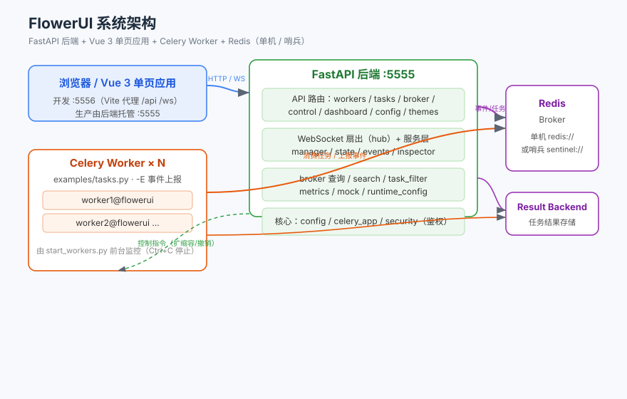
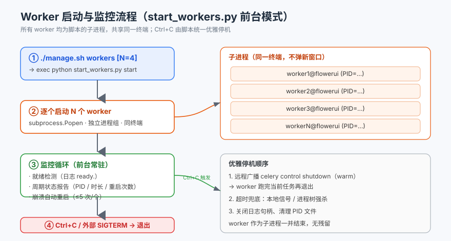
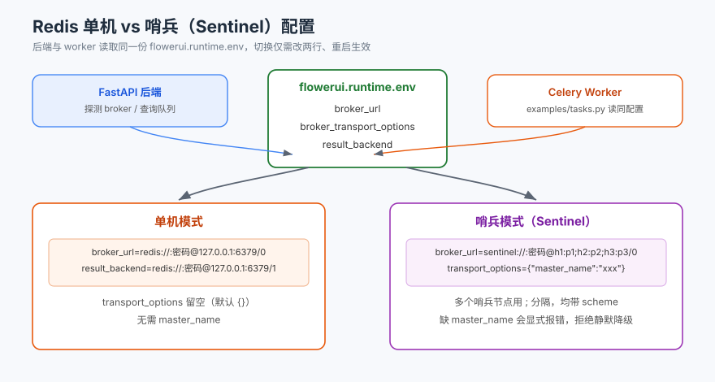

# FlowerUI 后端

> 基于 **FastAPI + Celery** 的实时任务 / 队列监控与管理服务（[mher/flower](https://github.com/mher/flower) 2.0.1 的前后端分离重构版）。
>
> 本文件仅描述**后端**，前端（Vue 3 + Element Plus）见仓库根 `README.md` 与 `frontend/`。

---

## 1. 概览

- **框架**：FastAPI + Uvicorn，单端口 **5555** 同时托管 API 与构建后的前端静态资源。
- **监控对象**：标准 Celery 集群（Worker / 任务 / Broker 队列），通过 Celery 事件总线实时采集。
- **传输层**：WebSocket 主动推送 + 定时轮询兜底，无需前端长轮询。
- **Broker 支持**：Redis 单机、**Redis 哨兵（Sentinel）高可用**（monitor 端与 worker 端需同时配置）。
- **零依赖演示**：`FLOWER_MOCK=true` 时启动内置模拟集群，无需任何 broker。

### 系统架构



---

## 2. 目录结构

```
backend/
├── flowerui/
│   ├── main.py                 # 应用装配、静态托管、生命周期（lifespan）
│   ├── core/
│   │   ├── config.py           # pydantic v1 BaseSettings + TOML 配置加载，字段对齐 flower CLI
│   │   ├── celery_app.py       # Celery 实例与 broker 探测（哨兵感知）
│   │   └── security.py         # Basic / JWT 鉴权
│   ├── services/
│   │   ├── manager.py          # ServiceManager 聚合入口
│   │   ├── state.py            # EventsState 内存状态机
│   │   ├── events.py           # 事件采集线程
│   │   ├── inspector.py        # Inspect 探针（含哨兵/单机/AMQP 的 broker 查询）
│   │   ├── broker.py           # Redis / RabbitMQ / Sentinel 队列查询
│   │   ├── search.py           # 任务搜索 DSL
│   │   ├── task_filter.py      # 过滤 / 排序 / 序列化
│   │   ├── metrics.py          # Prometheus 指标
│   │   ├── hub.py              # WebSocket 扇出
│   │   ├── mock.py             # 演示模式模拟集群
│   │   ├── restart.py          # 系统重启（调用 manage.sh restart）
│   │   └── runtime_config.py   # 运行时配置管理（界面改 → 落盘）
│   ├── api/routers/            # auth / workers / control / tasks / broker /
│   │                         dashboard / monitor / ws / config / system / themes
│   ├── static/                 # 前端构建产物（由 frontend/manage.sh build 同步）
│   └── themes/                 # 主题 CSS（目录即真理，上传落此；build 只补齐内置主题）
├── tests/                      # 功能自测：functional_check / e2e_check / smoke_control / test_* 等
├── docs/                       # 后端文档用 SVG 图（架构 / 启动监控流程 / 配置）
├── start_workers.py            # Worker 批量启动 + 前台监控（跨平台，不依赖 nohup）
├── send_tasks.py               # 随机发送测试任务
├── _broker_env.py              # 解析运行时配置（TOML 优先，兼容旧 .env）
├── manage.sh                  # 后端脚本（dev/run/demo/stop/status/workers/deps/upgrade/config）
├── pyproject.toml             # 依赖声明源（不锁版本，含 uv 镜像源）
├── uv.lock                    # 版本锁定（随代码提交，uv sync 按此还原）
├── .python-version            # 钉死 3.7，防止 uv sync 挑错解释器
├── requirements.txt           # 无 uv 环境 / Docker 的兼容入口（非权威来源）
├── flowerui-settings.toml     # 静态默认配置（可提交）
└── flowerui.runtime.toml      # 运行时覆盖配置（界面改 → 落盘，自动生成）
```

> 注：`examples/`（示例任务定义 `tasks.py`、种子脚本 `seed_tasks.py`）位于**项目根目录**，与 `backend/` 同级；`start_workers.py` / `send_tasks.py` 通过 `_broker_env.py` 读取 `backend/flowerui.runtime.toml` 自动配置 broker。

---

## 3. 环境准备（uv）

后端虚拟环境位于 **`backend/.venv`，Python 3.7.9**，由 uv 管理。
`backend/.python-version` 已把解释器钉在 3.7，避免 `uv sync` 误挑更高版本重建环境。

```bash
cd backend

# 首次创建环境 / 重装（自动按 uv.lock 精确还原）
uv sync

# 升级全部依赖到 Python 3.7 下的最新兼容版本
uv sync --upgrade

# 只升级某一个包
uv sync --upgrade-package fastapi
```

> **约定：以后升级后端依赖统一用 `uv sync`**，不要再手动改版本号或 `pip install`。
> - 依赖声明源：`pyproject.toml`（不锁版本，只保留 `pydantic<2` 与 `importlib-metadata<5` 两个必要上界）
> - 版本锁定：`uv.lock`（必须随代码提交）
> - `requirements.txt` 仅作为**无 uv 环境 / Docker 构建**的兼容入口，不是权威来源
> - `.venv` 内的 Python 为 3.7.9；项目根目录的 `.venv` 是早期 Python 3.9 环境，勿用

### 为什么保留两个上界

| 约束 | 原因 |
|---|---|
| `pydantic<2` | `flowerui/core/config.py` 使用 v1 的 `BaseSettings`，v2 已移到 `pydantic-settings` |
| `importlib-metadata<5` | kombu 5.2.4 依赖 `entry_points().get()`，5.0+ 移除该接口，否则 `celery.events` 导入失败 |

Python 3.7 下 uv 解析出的主要版本：fastapi 0.103.2 / starlette 0.27.0 / uvicorn 0.22.0 /
pydantic 1.10.27 / celery 5.2.7 / kombu 5.2.4 / redis 5.0.8 / httpx 0.24.1 / toml 0.10.2。

---

## 4. 快速开始

### 方式一：演示模式（零依赖，推荐先跑）

```bash
# 后端专属脚本
./manage.sh demo
# 等价于：
FLOWER_MOCK=true .venv/Scripts/python.exe -m uvicorn flowerui.main:app --host 0.0.0.0 --port 5555
```

打开 <http://127.0.0.1:5555> 即可看到 4 个模拟 worker 与持续事件流，所有控制指令均可真实操作。

### 方式二：连接真实 Celery 集群

```bash
# 1) 启动 broker（Redis 单机或哨兵，见第 8 节）
# 2) 启动后端（生产模式，单端口托管前端静态资源）
./manage.sh run
# 3) 另开一个终端，前台启动并监控 worker（Ctrl+C 停止）
./manage.sh workers          # 默认 4 个；可 ./manage.sh workers 8
```

> Worker 必须开启事件上报：`celery -A proj worker -E`。`start_workers.py` 已默认带 `-E`。

### 方式三：Celery 子命令启动（支持命令行参数）

```bash
# 一次性注册（幂等；uv sync 重建 venv 后需重新执行）
.venv/Scripts/python.exe register_celery_command.py
source .venv/Scripts/activate

# 启动（页面与 API 同一端口，默认 http://127.0.0.1:5555/）
celery -A celery_app flowerui
celery -A celery_app flowerui --port 5555 --mock
celery -A celery_app flowerui --broker-url redis://127.0.0.1:6379/0 --set debug=true
celery -A celery_app flowerui --port 6001 ui_transport=polling --dry-run
```

> **访问地址**：启动日志会打印 `页面地址`（把绑定用的 `0.0.0.0` 自动换成 `127.0.0.1`），
> 打开它即可；`--port` 改成 6001 就访问 `http://127.0.0.1:6001/`。
> `5556` 是 **Vite 前端开发端口**，只有 `./manage.sh dev` 才会在 5556 起服务；
> 单独用本方式启动时访问 5556 会得到空白 / 连接失败。前端静态资源由后端
> `flowerui/static/` 直接托管，无需另起前端进程。

`flowerui` 是通过 `celery.commands` entry point 注册的 click 命令，实现在 `flowerui/cli.py`；
`celery_app.py` 提供 `-A` 所需的 Celery 实例。注册脚本只改动当前 venv（写
`.dist-info` + `.pth`），不改 `pyproject.toml` / `uv.lock`，也不影响 `./manage.sh`。

> **发布形态**：`backend/` 同时是 PyPI 包 `flowerui` 的源码（`requires-python >=3.7`）。
> `uv build --project backend` 产出的 wheel 自带 `celery.commands` 与独立命令 `flowerui`
> 两个入口点，安装后**无需**执行上面的注册脚本。命令示例与当前限制见根 `README.md`
> 「方式六」及 `docs/pypi-release-plan.md`。

| 类别 | 参数 |
| --- | --- |
| 服务 | `--host` / `--address`、`--port` / `-p`、`--url-prefix`、`--log-level`、`--reload`、`--workers` |
| Celery | `--broker-url`、`--result-backend`、`--broker-transport-options`（JSON）；全局 `-b/--broker` 亦生效 |
| 运行模式 | `--mock` / `--no-mock`、`--debug` / `--no-debug`、`--basic-auth`、`--basic-auth-enabled` |
| 配置 | `--runtime-config PATH` 指定运行时 TOML；`--set KEY=VALUE` 或位置参数 `KEY=VALUE` 覆盖任意配置项 |
| 调试 | `--list-keys` 列出全部配置键、`--dry-run` 只打印生效配置不启动 |

**优先级**：命令行 > `flowerui.runtime.toml` 回放 > `FLOWER_*` 环境变量 >
`flowerui-settings.toml` > 代码默认值。`runtime_config.set_cli_overrides()` 会登记
命令行键，`load()` 回放磁盘配置时跳过它们；覆盖项同时写入 `FLOWERUI_CLI_OVERRIDES`
环境变量，使 `--reload` / `--workers` 的子进程保持一致。命令行参数**不落盘**，重启后仍以 TOML 为准。

> 注意：Celery 全局选项（`-A`、`-b`、`--result-backend` 等）必须写在 `flowerui` 之前。
> Git Bash 下用注册脚本生成的 `celery` shim 绕开 uv 0.12.3 在 Windows + Python 3.7
> 下损坏的 `celery.exe`；PowerShell / CMD 请用 `.venv/Scripts/python.exe -m celery ...`。

---

## 5. 服务管理（`manage.sh`）

所有命令在 `backend/` 目录下执行（Git Bash / Linux / macOS 通用）。

| 命令 | 说明 |
| --- | --- |
| `./manage.sh dev` | 开发模式：停 + 起（`--reload` 默认关，可加 `--reload` 开热更新） |
| `./manage.sh dev --mock` | 开发模式 + 模拟数据 |
| `./manage.sh dev --clean` | 开发模式 + 启动前清理历史日志 |
| `./manage.sh restart` | 重启（等价于 `dev`，先停后起） |
| `./manage.sh run` | 生产模式：**前台**运行，单端口托管前端静态资源 |
| `./manage.sh demo` | 演示模式：模拟集群，无需 broker |
| `./manage.sh stop` | 仅停止后端（精确定位端口 5555，不误杀 celery worker） |
| `./manage.sh status` | 环境摘要 + 端口存活 + `/api/system` 生效配置 |
| `./manage.sh clean` | 清理 `backend/logs/` 下历史日志（仅删 `*.log`，保留 PID 文件） |
| `./manage.sh workers [N=4]` | **前台**启动并监控 N 个 worker（Ctrl+C 停止，详见第 6 节） |
| `./manage.sh deps` | 依赖还原 `uv sync`（按 `uv.lock`，**唯一入口**） |
| `./manage.sh deps --upgrade` / `./manage.sh upgrade` | 升级到 Python 3.7 下的最新兼容版 |
| `./manage.sh deps --upgrade-package <包名>` | 只升级单个包 |
| `./manage.sh deps --add <包名>` | 新增依赖（`uv add`，改 `pyproject.toml` + `uv.lock`） |
| `./manage.sh deps --check` | 只读体检：版本清单 + `pydantic<2` / `importlib-metadata<5` |
| `./manage.sh config` | 配置体检：TOML 可解析性 / 分节误用 / `FLOWER_*` 覆盖 / 生效值 |
| `./manage.sh help` | 显示帮助 |

> **后台行为说明**：`dev` / `restart` / `demo` 会将 uvicorn 以后台方式拉起（关终端不影响服务）；`run` 为前台（`exec`）。`workers` 始终为前台监控模式——这是有意设计，便于你直接观察 worker 状态并在结束时用 Ctrl+C 一并收回。
>
> **与根脚本的关系**：本脚本也由根目录 `./manage.sh` 统一调度（`dev` / `run` / `demo` / `stop` / `workers` / `deps` / `upgrade` / `config` / `status` 会转发到此）；项目打包请用根目录 `./manage.sh pack ./backend`（按本目录 `.gitignore` 排除 `.venv` 等运行时产物）。
>
> **日志位置**：所有运行时日志与 PID 文件统一放在后端自己的 `backend/logs/` 下——`backend/logs/`（uvicorn 标准输出 / 错误 + `_backend.pid`）、`backend/logs/workers/`（各 worker 日志与 PID）。`clean` 仅删除 `*.log`，PID 文件保留以便 `stop` 精确杀进程。

---

## 6. Worker 管理（`start_workers.py`）

纯 Python、跨 Windows / Linux，**不依赖 `nohup`**。每个 worker 都是脚本的子进程，共享同一终端（不弹新窗口）：

```bash
# 前台启动 4 个 worker 并持续监控（Ctrl+C 停止并带走全部 worker）
python start_workers.py start
python start_workers.py start 8 --no-restart --interval 2

# 其它操作（非监控场景）
python start_workers.py status        # 查看运行状态
python start_workers.py logs 1 -f     # 跟踪第 1 个 worker 日志
python start_workers.py stop          # 从另一个终端停止（通知监控脚本退出）
```

### 启动与监控流程



行为要点：

- **多进程、同终端**：worker 作为脚本子进程启动，不弹新窗口；Windows 用 `DETACHED_PROCESS` 之外的独立进程组，控制台 Ctrl+C 由脚本统一接管。
- **崩溃自愈**：worker 异常退出自动重启（单个最多 5 次），超限后放弃并提示查日志。
- **日志落盘**：每个 worker 的日志写入 `backend/logs/workers/_worker_{N}.log`，可用 `python start_workers.py logs N [-f]` 查看 / 跟踪；PID 文件同目录。
- **优雅停机**：Ctrl+C / `SIGTERM` → 先通过 broker 控制通道广播 `celery control shutdown`（warm shutdown，跑完当前任务再退出）→ 超时兜底信号 / 强杀 → 清理 PID 文件，**无残留**。
- **broker 自动跟随**：从 `flowerui.runtime.toml` 读取 `broker_url` / `broker_transport_options` / `result_backend`，后端切哨兵 / 单机后 worker 无需改配置。

### 与 `manage.sh workers` 的关系

`./manage.sh workers [N]` 等同于 `exec python start_workers.py start [N]`——只做前台透传，不再有 `start/stop/status/restart/logs` 子命令（那些直接用 `start_workers.py` 即可）。

---

## 7. 随机发任务（`send_tasks.py`）

用于快速制造任务流量，验证仪表盘与 worker 消费：

```bash
python send_tasks.py --count 10          # 随机发 10 个任务（经后端 API）
python send_tasks.py --count 50 --poll   # 发完轮询直到全部完成
python send_tasks.py --seed 42           # 固定随机种子，复现特定任务组合
python send_tasks.py --list              # 仅列出可用任务类型
```

---

## 8. 配置

### 8.1 配置文件（TOML）与环境变量

静态默认配置见同目录 [`flowerui-settings.toml`](flowerui-settings.toml)（**扁平** `KEY = VALUE`，
不要分节：分节写法会被 `extra="ignore"` 静默丢弃，且 TOML 没有 `null`）。
界面改动落盘到 `flowerui.runtime.toml`，重启生效。优先级：
**TOML 文件 → `FLOWER_*` 环境变量 → 代码默认值**。

用 `./manage.sh config` 可体检两个 TOML 是否可解析、有无分节误用、`result_backend`
是否被误写成空串，以及当前环境变量覆盖；服务运行时用 `./manage.sh status` 看真正生效值。
完整字段清单见 `flowerui-settings.toml` 与界面「配置」页。

常用环境变量：

| 变量 | 默认值 | 说明 |
| --- | --- | --- |
| `FLOWER_BROKER_URL` | `redis://127.0.0.1:6379/0` | 支持 `redis://` / `rediss://` / `sentinel://` |
| `FLOWER_BROKER_TRANSPORT_OPTIONS` | `{}` | **哨兵必填** `master_name` |
| `FLOWER_RESULT_BACKEND` | 空 | 任务结果查询 |
| `FLOWER_MAX_TASKS` | `100000` | 内存保留任务上限 |
| `FLOWER_INSPECT_TIMEOUT` | `3000` | Inspect 超时（毫秒） |
| `FLOWER_BASIC_AUTH` | 空 | `["user:pass"]`，留空不鉴权 |
| `FLOWER_SECRET_KEY` | 随机 | JWT 签名，生产必改 |
| `FLOWER_MOCK` | `false` | 强制演示模式 |

### 8.2 运行时配置

界面修改的配置自动落盘到 `flowerui.runtime.toml`（TOML 格式），**重启后端生效**。后端启动后可在 `/api/config/ui` 查看默认值。

- `result_backend` **非必须**：不提供结果查询时保持注释状态即可，生成模板只写注释行。写成
  `result_backend = ""` 会让 Celery 认为「已配置但为空」并抛 `NotImplementedError: No result backend is configured`。
- 运行时文件按**当前工作目录**解析，所以 `manage.sh` 启动后端前会 `cd backend/`；从项目根目录
  直接 `python -m uvicorn ... --app-dir backend` 启动会读不到界面保存的配置。
- 恢复出厂配置：`POST /api/config/materialize`，或删除 `flowerui.runtime.toml` 后重启。

### 8.3 Redis 哨兵 vs 单机



**哨兵模式**（monitor 端与 worker 端都需配置）：

> 下列地址、端口、密码与 `master_name` **均为示例占位**，请按实际环境替换；切勿把真实连接信息写进文档或提交到仓库。

```toml
# flowerui.runtime.toml（TOML 键名无 FLOWER_ 前缀）
broker_url = "sentinel://:YOUR_PASSWORD@sentinel1.example.com:26379;sentinel://sentinel2.example.com:26379;sentinel://sentinel3.example.com:26379/0"
broker_transport_options = { "master_name" = "mymaster" }
result_backend = "sentinel://sentinel1.example.com:26379;sentinel://sentinel2.example.com:26379;sentinel://sentinel3.example.com:26379/1"
```

- 多个哨兵节点用 `;` 分隔，每个都要带 `sentinel://` scheme；db 写在任意一段路径上（如 `/0`）。
- `master_name` 缺失时启动会**显式报错**，拒绝静默降级到演示模式。

**Worker 端**（`../examples/tasks.py`，即项目根 `examples/tasks.py`，已内置同样的读取逻辑）：

```bash
FLOWER_BROKER_URL='sentinel://:YOUR_PASSWORD@127.0.0.1:26379;sentinel://127.0.0.1:26380;sentinel://127.0.0.1:26381/0' \
FLOWER_RESULT_BACKEND='sentinel://:YOUR_PASSWORD@127.0.0.1:26379;sentinel://127.0.0.1:26380;sentinel://127.0.0.1:26381/1' \
FLOWER_BROKER_TRANSPORT_OPTIONS='{"master_name": "mymaster"}' \
python start_workers.py start 4
```

**切回单机**：把 `FLOWER_BROKER_URL` 改回 `redis://:YOUR_PASSWORD@127.0.0.1:6379/0`、删掉 `FLOWER_BROKER_TRANSPORT_OPTIONS` 即可，两种模式可在 `flowerui.runtime.toml` 中随时切换（重启生效）。

---

## 9. API 参考

启动后访问 <http://127.0.0.1:5555/docs> 查看交互式 Swagger 文档（ReDoc 见 `/redoc`）。

**查询**：`/api/workers`、`/api/workers/table`、`/api/worker/{name}`、`/api/tasks`、`/api/tasks/table`、`/api/task/info/{id}`、`/api/task/types`、`/api/task/registered`、`/api/queues/length`、`/api/broker`、`/api/dashboard/summary|timeline|filters|task-distribution`、`/api/system`、`/api/config`、`/api/config/ui`、`/api/themes`。

**控制**：`/api/worker/shutdown/{name}`、`/api/worker/pool/restart|grow|shrink|autoscale/{name}`、`/api/worker/queue/add-consumer|cancel-consumer/{name}`、`/api/task/revoke/{id}`、`/api/task/abort/{id}`、`/api/task/rate-limit|timeout/{taskname}`、`/api/task/apply|async-apply|send-task/{taskname}`、`/api/task/result/{id}`。

**配置 / 运维**：`PUT /api/config`、`POST /api/config/reset|materialize`、`POST /api/system/restart`、`GET /metrics`、`GET /healthcheck`、`WS /ws/events`。

---

## 10. 测试

```bash
# 1) 启动服务（演示模式零依赖）
./manage.sh demo
# 2) 另开终端运行端到端自测
.venv/Scripts/python.exe tests/functional_check.py http://127.0.0.1:5555
```

覆盖：系统 / 认证、仪表盘、Worker 列表与详情、任务下发与查询、任务控制（revoke / terminate / rate-limit / timeout）、Worker 池与队列控制、Broker / 队列长度、运行时配置、主题、系统重启接口。全部通过即代表核心链路健康。

> 已知约定：认证未启用时 `/api/auth/login` 对任意凭据返回 200（匿名 token），测试将其标记为预期失败属正常；`POST /api/system/restart` 需默认端口 5555 上运行才能验证服务恢复。

---

## 11. 故障排查

| 现象 | 原因 / 处理 |
| --- | --- |
| 启动即降级为演示模式 | broker 不可达，或哨兵模式缺 `master_name`。查日志确认报错；`master_name` 缺失会显式拒绝降级 |
| `NOAUTH Authentication required` | broker 密码不正确或未从 `flowerui.runtime.toml` 读取。两端（后端 / worker）密码需一致 |
| worker 频繁 `code=1` 且日志无明显报错 | 同名 `workerN@flowerui` 被另一 supervisor 踢掉——**不要在同一 broker 上重叠启动两个 `start_workers.py`**，停掉其一再起 |
| `./manage.sh workers` 启动后终端被占用 | 这是前台监控的预期行为；结束按 `Ctrl+C` 即可优雅收回全部 worker |
| Windows 下 `taskkill` 报“无效的参数” | 曾被 MSYS 路径转换坑过；脚本已全局 `MSYS_NO_PATHCONV=1`，无需手动处理 |
| 任务列表搜索无结果 | 检查搜索 DSL：`result:success`、`state:FAILURE`、`args:user_id`，多条件空格取交集 |
| 页面白屏 / `ERR_ADDRESS_INVALID` | 打开的是启动日志里的 `0.0.0.0`；它是网卡绑定值，请用启动日志 `页面地址` 行的 **<http://127.0.0.1:5555/>**（`--port` 改了就换端口） |
| 访问 5556 白屏 | 5556 是 Vite 开发端口，只有 `./manage.sh dev` 才启动；本方式由后端单端口托管前端，访问 5555 |
| 界面在但 Worker / 任务全 0 | 真实 broker 尚无 Worker 与任务时的正常空数据；加 `--mock` 或改用 `./manage.sh demo` |
| 只返回 `前端未构建` 的 JSON | `flowerui/static/index.html` 缺失；先执行根 `./manage.sh build`（或设置 `FLOWER_FRONTEND_DIST` 指向已构建目录） |
| 仍白屏但接口都 200 | `Ctrl+F5` / 无痕窗口排除浏览器缓存；再看 F12 Console，服务端用 `curl -I http://127.0.0.1:5555/` 确认 |

---

## 12. 许可证

MIT License
