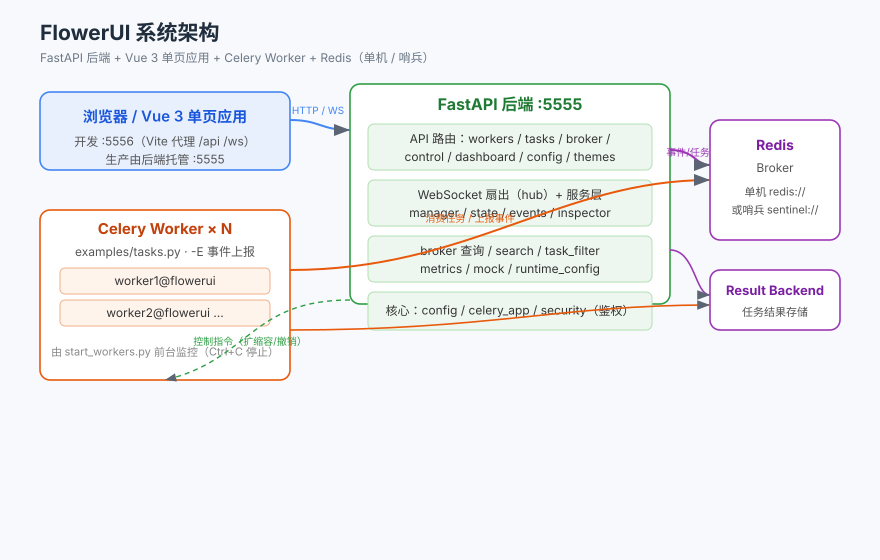

# FlowerUI 前端

> 基于 **Vue 3 + Element Plus + Vite** 的管理界面（[mher/flower](https://github.com/mher/flower) 2.0.1 的前后端分离重构版前端）。
>
> 后端（FastAPI + Celery）见仓库根 `README.md` 与 `backend/README.md`。

---

## 1. 概览

- **框架**：Vue 3 + Element Plus，Vite 构建。
- **开发服务器**：Vite 热更新，端口 **5556**，通过代理把 `/api` 与 `/ws` 转发到后端 5555。
- **生产产物**：构建后输出到 `frontend/dist/`，并经 `frontend/manage.sh build` 同步到 `backend/app/static/`（全量替换）；主题目录只补齐内置主题、不覆盖，由后端单端口 5555 托管。
- **主题系统**：内置暗色 / 亮色主题，支持在界面上传自定义 CSS（"目录即真理"：上传即识别，重启后保持）。

### 系统架构



---

## 2. 目录结构

```
frontend/
├── src/
│   ├── api/                    # axios 封装 + WebSocket 客户端
│   ├── stores/                 # Pinia 状态管理
│   ├── composables/            # 组合式函数
│   ├── layouts/AppLayout.vue   # 主布局（可折叠导航 / 登录态）
│   ├── components/             # 通用组件
│   ├── views/                  # 页面（Workers / Tasks / Broker / Dashboard / 配置 等）
│   ├── styles/                 # 全局样式
│   └── theme/                  # 主题变量
├── vite.config.js              # Vite 配置（开发端口 5556，代理 /api /ws → 5555）
├── package.json
├── index.html
├── dist/                       # 构建产物（由 manage.sh build 生成，已 gitignore）
└── manage.sh                  # 前端专属服务管理（dev/build/stop/status/clean/help）
```

> 注：项目根 `themes/` 是**内置主题素材**，`frontend/manage.sh build` 会把它补齐到 `backend/app/themes/`；**运行时真理源是 `backend/app/themes/`**（界面上传的 CSS 直接落这里）。`examples/` 与 `backend/` 同级。

---

## 3. 环境准备

```bash
cd frontend
# 安装依赖（国内镜像）
npm install --registry=https://registry.npmmirror.com
```

> 需要 Node.js（建议 18+）与 npm。依赖已写入 `package.json`。

---

## 4. 快速开始

### 方式一：开发模式（推荐，热更新）

```bash
# 前端专属脚本（Vite 5556，后台运行，关终端不影响）
./manage.sh dev
# 等价于根脚本的 ./manage.sh dev（前后端一起拉起）
```

打开 <http://127.0.0.1:5556>，Vite 自动代理后端 API 与 WebSocket。

### 方式二：仅构建产物（交给后端托管）

```bash
# 构建并同步到 backend/app/static（+ 主题到 backend/app/themes）
./manage.sh build
```

后端以 `run` / `demo` / `celery -A celery_app flowerui` 启动后，访问 <http://127.0.0.1:5555> 即为该构建产物。
**这种方式不会启动 Vite**，5556 端口没有服务，不要访问 5556。

---

## 5. 服务管理（`manage.sh`）

所有命令在 `frontend/` 目录下执行（Git Bash / Linux / macOS 通用）。

| 命令 | 说明 |
| --- | --- |
| `./manage.sh dev` | 开发模式：停 + 起（Vite 热更新，端口 5556，**后台**运行） |
| `./manage.sh restart` | 重启（等价于 `dev`，先停后起） |
| `./manage.sh build` | 构建前端产物并同步到 `backend/app/static`（+ 主题到 `backend/app/themes`） |
| `./manage.sh stop` | 仅停止前端（按端口 5556 精确定位，不误杀后端 / worker） |
| `./manage.sh status` | 查看前端运行状态 |
| `./manage.sh clean` | 清理 `frontend/logs/` 下历史日志 |
| `./manage.sh help` | 显示帮助 |

> **后台行为说明**：`dev` / `restart` 将 Vite 以后台方式拉起（关终端不影响服务，PID 记在 `frontend/logs/_vite.pid`，日志在 `frontend/logs/vite.log`）；`build` 为一次性前台构建。
>
> **日志位置**：运行时日志各自放在项目自己的目录下——前端在 `frontend/logs/`（Vite 日志与 `_vite.pid`），后端在 `backend/logs/`（uvicorn 日志与 `_backend.pid`）及 `backend/logs/workers/`（各 worker 日志与 PID）；`./manage.sh clean` 可清理各自历史日志（保留 PID）。

---

## 6. 构建与同步

`build` 流程：

1. 预清理 `dist/`（规避部分环境下 Vite 清空输出目录被安全机制拦截）。
2. `npm run build` 输出到 `frontend/dist/`。
3. 同步到后端：
   - `frontend/dist/` → `backend/app/static/`（先清空再整体拷贝）。
   - 项目根 `themes/*.css` → `backend/app/themes/`：默认**只补齐目标中缺失的文件**，不覆盖、不删除（保护界面上传/改过的主题）。可用 `FLOWER_SYNC_THEMES=overwrite|skip` 改变策略。

这样根 `./manage.sh run|demo` 时，后端单端口 5555 即可托管最新前端，无需额外静态服务器。

---

## 7. 主题

- 界面「主题」页可上传自定义 CSS；后端以「目录即真理」管理：`backend/app/themes/*.css` 即一个主题，共享变量放在 `base.css`（其它主题 `@import`），上传即识别、重启保持。
- **`backend/app/themes/` 是唯一运行时真理源**。项目根 `themes/` 只是内置主题素材，`build` 默认只补齐缺失文件，**不会**覆盖或删除后端目录里已有的主题（含用户上传的）。
- 确需让仓库版本覆盖同名主题：`FLOWER_SYNC_THEMES=overwrite ./manage.sh build`；完全不动主题：`FLOWER_SYNC_THEMES=skip ./manage.sh build`。
- 后端新增的配置项（如 `result_backend`）需要重新 `./manage.sh build` 后才会出现在配置页。

---

## 8. 与后端 / 根脚本的关系

- 本目录的 `manage.sh` 是**前端专属**脚本，只管前端（5556 与构建同步），不会触碰后端或 celery worker。
- 根目录 `./manage.sh` 为编排层：
  - `dev` / `restart` → 同时调用 `backend/manage.sh dev` 与 `frontend/manage.sh dev`
  - `run` / `demo` / `build` → 先 `frontend/manage.sh build` 同步产物，再 `backend/manage.sh run|demo`
  - `stop` / `clean` / `status` → 分别调度前后端子脚本
  - `workers [N]` / `deps` / `upgrade` / `config` → 转发到 `backend/manage.sh`

> 根目录不再保留 `dev-restart.ps1` / `start_worker.bat` / `start_worker.sh` / `run.py`：
> 所有启停、依赖、worker 与配置操作统一走 `manage.sh`。

---

## 9. 故障排查

| 现象 | 原因 / 处理 |
| --- | --- |
| 5556 起不来 | 端口被占用；`./manage.sh stop` 后再 `dev`，或查 `frontend/logs/vite.log` |
| 页面空白 / API 404 | 后端未启动，或 `/api` 代理未生效；确认后端 5555 在运行 |
| 没起 Vite、只启动后端时访问 5556 白屏 | 5556 仅在 dev 模式存在；`run` / `demo` / `celery -A celery_app flowerui` 都是后端单端口托管，应访问 <http://127.0.0.1:5555/> |
| 打开 `http://0.0.0.0:5555` 白屏 | `0.0.0.0` 是网卡绑定值不是访问地址（浏览器报 `ERR_ADDRESS_INVALID`）；改用 `127.0.0.1` |
| 界面在但数据全 0 | 真实 broker 无 Worker / 任务；后端加 `--mock` 或用 `./manage.sh demo` 查看演示数据 |
| 主题不生效 | 确认 `backend/app/themes/` 下有对应 CSS；界面上传后刷新即可 |

---

## 10. 许可证

MIT License
